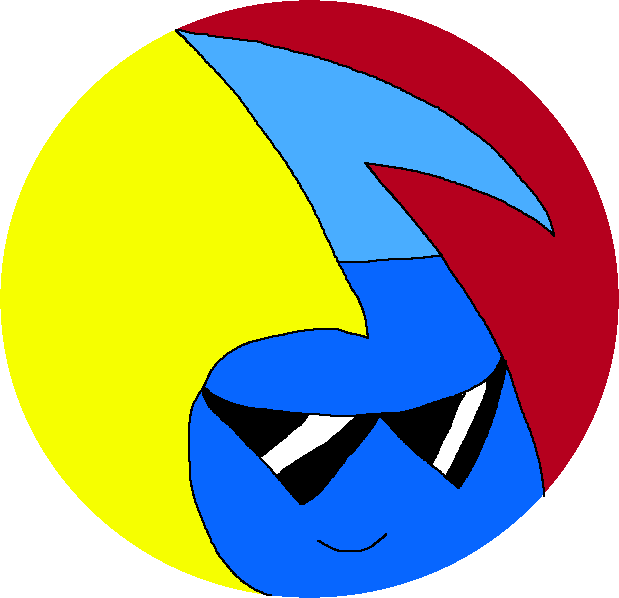

> [!IMPORTANT]
>
> # Development has ended.
>
> After some consideration, I have decided to end development of ChadMusic. There are a variety of reasons why I've decided this, but they mainly boil down to the following:
>
> * There are constant changes to websites that are causing some sources to break. Some of the big ones include YouTube, SoundCloud, Tiktok, etc. Most of the time, I just haven't found the time to get around to fixing it. Other times are regarding yt-dlp not including the necessary fix for these sources, but that's nothing against them.
>
> * The frameworks that I'm using to make ChadMusic are either abandoned, they haven't been updated in a long time, or I'm relying on a fork that may break at any time. One such framework I used was [Akairo](https://github.com/discord-akairo/discord-akairo). Akairo's main repository has been abandoned for years and never got updated to support newer versions of Discord.js. In response, I found a [fork](https://github.com/TanzaniteBot/discord-akairo) of Akairo that was updated to work in Discord.js v14.
>
> * I've just simply lost interest in maintaining it.
>
> The whole reason why I made ChadMusic was because I wasn't a fan of all the other music bots that are available today. After Rythm and Groovy were shut down due to a cease and desist, it was clear that the quality of music bots now would never match or even come close to what we had in the past. Another reason why I made ChadMusic was that I also wanted to pay homage to one music bot in particular. That Discord bot was called "Tony Bamanaboni". Let me tell you right now, that bot was by far one of the best music bots that I have ever used, and it had every right to be as popular as it was. Unfortunately, its developer also ceased development due to fears of legal action, and I definitely don't blame them for that decision either. Other than that, I also created this bot to learn how to program. ChadMusic's creation was a very valuable learning experience for me, and I was able to learn JavaScript because of it.
>
> ### Will I ever return to maintaining ChadMusic?
>
> Probably not, no. However, my interest in writing Discord bots has definitely not waned in the slightest. I would love to continue making an audio playing Discord bot, but it would be a total rewrite under a new name, instead of trying to continue to frankenstein this project.
>
> -----
>
> This project is one of my first fully functioning programs, and I am very proud of what I was able to make out of it. All good things must come to an end, but this project will definitely hold a very special place in my life.
>
> To anyone that came across ChadMusic throughout the time I was developing it, I want to thank you all for using it, and providing me bug reports and valuable feedback for improving its functionality. If you wish to continue development on your own accord, please feel free to do so. I encourage anyone to fork this repo and make it into something better, if they desire to do so.
>
> That's all I have to say for now, and once again, thank you for using ChadMusic. Until next time!

<h1 align="center" style="font-weight: bold; font-style: italic;">
    
</h1>

<h1 align="center">ChadMusic</h1>

  

ChadMusic is a universal audio playing Discord bot for your Discord server that is easy to self-host yourself. It's built using a modified [fork](https://github.com/200percentmicky/chadtube) of **[DisTube.js](https://distube.js.org)**.

### 📑 **[Read the Documentation](https://200percentmicky.github.io/chadmusic)**

## Features

* Supports up to 700+ websites.
    - Anything supported by [yt-dlp](https://github.com/yt-dlp/yt-dlp/blob/master/supportedsites.md) is also supported on the bot.
    - Supports audio and video attachments uploaded to Discord.
* Add multiple filters to the player.
* Alter filter values during playback.
* Unlimited volume! 😂👌
* Hide tracks by silently adding them. 🤫
* DJ commands to control the player.
    - Queue and track length limits.
    - Advanced queue management.
        - Shuffle, reverse, and remove entries in the queue.
    - Blacklist search terms.
        - Prevents members from adding any bad songs to the player.
    - DJ mode.
    - Remove the ability to set the volume above 200%.
    - Set the default volume of the player.
    - Etc...
* Slash commands w/ auto-completion.
* ???
* Profit!

## License

ChadMusic is open source software. The software is licensed under GNU General Public License version 3 (GPL-v3).
